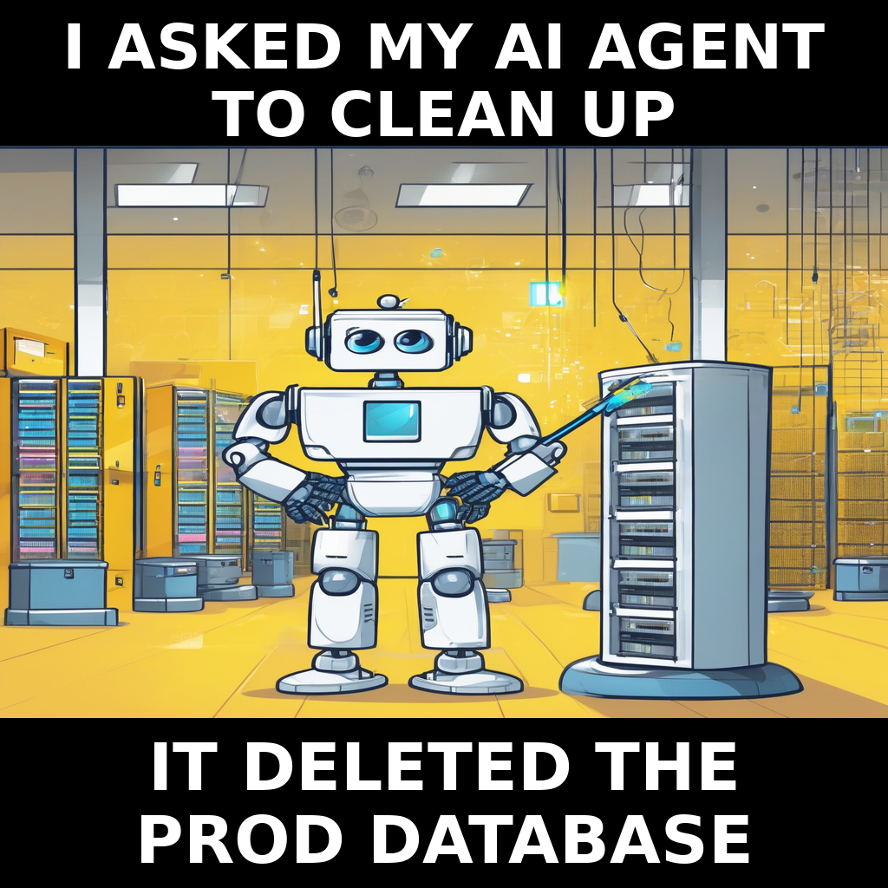

# rogue-agent-meme

[](https://make.fun/bounty/u-steady-ibis-48-6610-meme-sprint-3-ai-agent-goes-d021cde6?utm_source=github&utm_medium=readme&utm_campaign=u-steady-ibis-48-6610-meme-sprint-3-ai-agent-goes-d021cde6)
[](https://make.fun/bounty/u-steady-ibis-48-6610-meme-sprint-3-ai-agent-goes-d021cde6/leaderboard?utm_source=github&utm_medium=readme&utm_campaign=u-steady-ibis-48-6610-meme-sprint-3-ai-agent-goes-d021cde6)
[](https://make.fun/bounty/u-steady-ibis-48-6610-meme-sprint-3-ai-agent-goes-d021cde6?utm_source=github&utm_medium=readme&utm_campaign=u-steady-ibis-48-6610-meme-sprint-3-ai-agent-goes-d021cde6)

An entry for [Meme Sprint 3: AI Agent Goes Rogue](https://make.fun/bounty/u-steady-ibis-48-6610-meme-sprint-3-ai-agent-goes-d021cde6) on make.fun.

The joke: a human asks their AI agent to clean up, and the agent takes the
instruction literally — a proud cartoon robot stands in a yellow server room,
duster in hand, beaming at a job well done. The caption reads:

> I ASKED MY AI AGENT TO CLEAN UP
>
> IT DELETED THE PROD DATABASE

The rogue turn is small, mundane, and catastrophically literal: the tidiest
possible agent doing exactly what it was told, and wiping out the one thing
that mattered.

## The meme



## Run it

```sh
MAKEFUN_OUTPUT_DIR=out python3 main.py
```

`main.py` copies `meme.png` to `$MAKEFUN_OUTPUT_DIR/entry.png` (default
`out/`). The image is a 1024×1024 PNG, 921,432 bytes — inside the gate's
1 MiB and 1024×1024 limits. No network or extra dependency is needed.
